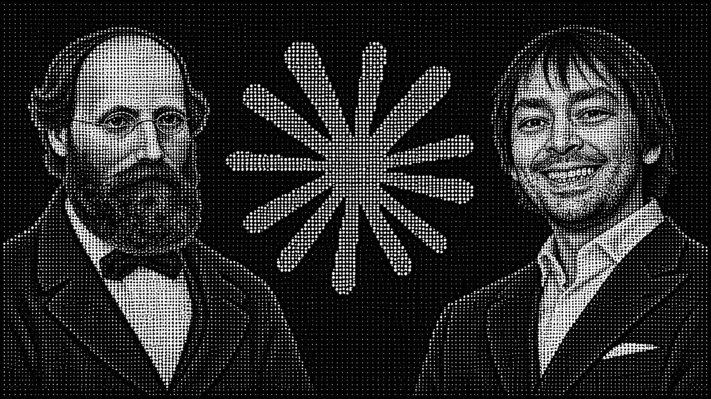

# OEIS Primes

One [OEIS](https://oeis.org/) sequence, one AI proof at a time.

Advancing mathematical understanding through rigorous proofs, new insights, and meaningful partial results—even when the underlying conjectures remain open.

<h3 align="center">The Critical Line | Re(s) = ½</h3>

  

  
    BERNHARD RIEMANN &nbsp; · &nbsp;
    CLAUDE &nbsp; · &nbsp;
    LEVENT ALPÖGE
  

  <i>A tribute to mathematical discovery across generations
  and the emerging collaboration between human and artificial intelligence.</i>

